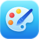

  

# Glow

A creative light art tool by [retrac.space](https://retrac.space), live at [glowstudio.retrac.space](https://glowstudio.retrac.space/). Create glowing drawings, experiment with light, explore symmetry, and design colorful particle effects.

## Controls

| Control | Mouse | Touch | Key |
| --- | --- | --- | --- |
| Steer the tubes | Move | Drag with the Steer tool, several fingers split the tubes | `1` |
| Draw a braid | Drag | Drag with the Draw tool | |
| Black hole | Click to place, click one to remove, drag to move | Same, with taps | `B` |
| Particle Burst | Click | Tap | `E` |
| Mirror | Toolbar: left and right, top and bottom, or both | Same | `M` cycles |
| Freeze time | Toolbar | Toolbar | `F` or `Space` |
| Chaos | Toolbar | Toolbar | `X` |
| Clear canvas | Toolbar | Toolbar | `C` |

Colors, glow, tube count, speed, trail length, background and reduced effects are in the settings panel. Reduced effects starts on when the system asks for reduced motion.

## How much is Glow?
Glow is completely free and open source! However, some features like the gallery require a retrac.space account. retrac.space accounts are also free to sign up for.
Glow is free because it is just a personal side-project, not a monetized app.
